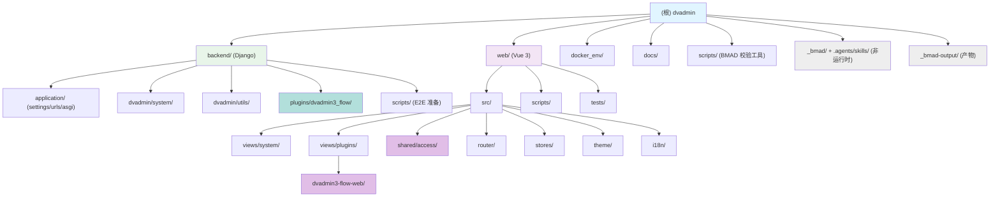
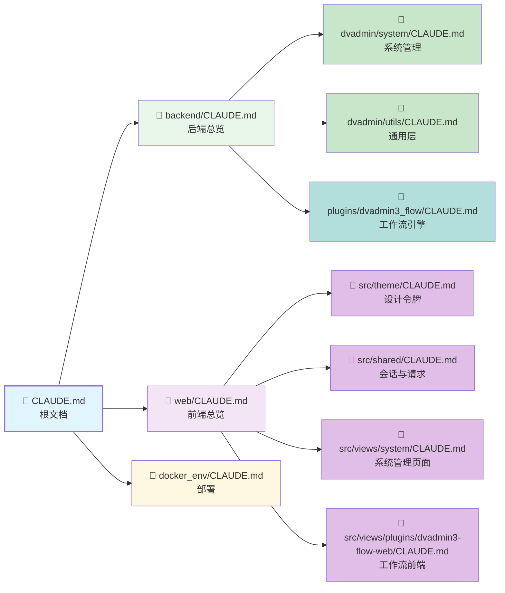

# DVAdmin 项目文档

> 最后更新：2026-10-29
> 仓库根目录：`D:\project\01-自研项目\dvadmin`（Git 仓库根；文档生成时分支 `master`）
> 文档口径：以当前工作树中的实际文件、配置和脚本为准；历史模块与旧路径单独标注。

> 注意：根目录的 `README.md`、`README.zh.md` 仍保留部分旧路径和旧命令（例如 `django-vue3-admin-master/`、`start_daphne.ps1`、npm/yarn）。当前目录导航、环境要求和启动方式以本文档与 [START.md](./START.md) 为准。
>
> 早期文档里写的仓库根 `E:\project\管理后台\dvadmin` 是同一仓库的另一台机器路径；本文件统一使用当前路径。

---

## 变更记录

| 日期 | 变更 |
|------|------|
| 2026-10-29 | **移除设计工单板块**：删除后端 `dvadmin.design_order`（9 模型、25 迁移、9 张表）、前端页面与两条路由、用户页「平台权限」弹窗与两个接口、7 条菜单 + 45 个按钮 + 3 组字典、9 个测试文件与两份模块文档；`boto3` 依赖移除。备份与业务数据导出见 `scratch/backup/design-order-removal/`。 |
| 2026-10-26 | **增量更新（第 2 次运行）**：新增 **3 份模块级 `CLAUDE.md`**（`backend/dvadmin/design_order`、`web/src/views/design_order`、`web/src/views/plugins/dvadmin3-flow-web`），模块文档由 9 份增至 **12 份**；补记根 `scripts/`、`AGENTS.md`、`_bmad/`、`_bmad-output/`、`.agents/skills/` 的性质；校正仓库根路径为 `D:\project\01-自研项目\dvadmin`；补 Univer 0.25.1、design_order 测试入口、迁移漂移和 Icon/源库配置等已知限制。 |
| 2026-10-25 | 新增 **9 份模块级 `CLAUDE.md`**（backend、system、utils、dvadmin3_flow、web、theme、shared、views/system、docker_env），确立"根级简明 + 模块级详尽"的双层文档结构；根文档补模块索引表与模块文档 Mermaid 图；模块文档统一带导航面包屑。 |
| 2026-10-25 | 按当前仓库重写文档：仓库根直接包含 `backend/`、`web/`、`docker_env/`、`docs/`；修正 Node 24 / pnpm 与 Python / uvicorn 启动入口；首次初始化与日常启动分离；补充 `pnpm test:unit` 的 Windows 环境排障；移除默认账号密码和已删除模块的现存功能描述。 |
| 2026-06-03 | 历史：删除博客管理模块及独立博客前端。当前仓库不再包含博客功能。 |
| 2026-02-08 | 历史：新增博客前端与主题/样式文档；其中博客相关文档已不再代表当前功能。 |
| 2026-02-03 | 历史：Django 升级与 Celery 配置调整；当前实际版本以 `backend/requirements.txt` 为准。 |
| 2026-01-25 | 历史：补充前端子模块文档与工作流插件说明。 |
| 2026-01-24 | 历史：初始化项目根文档。 |

---

## 当前项目概述

DVAdmin 是基于 RBAC 的 Django + Vue 3 前后端分离后台框架。当前仓库保留：

- **系统管理**：用户、角色、菜单/按钮/字段权限、部门、字典、地区、文件、下载中心、操作日志、登录日志、消息中心、系统配置、接口白名单。
- **工作流审批插件**：`backend/plugins/dvadmin3_flow/`，后端路由前缀为 `/api/dvadmin3_flow/`，前端页面位于 `web/src/views/plugins/dvadmin3-flow-web/`。
- **Celery 任务管理**：前端页面位于 `web/src/views/celery/`；后端 Celery 配置位于 `backend/application/settings.py`，`dvadmin3_celery` 由该文件导入（见“已知限制”）。
- **前端基础设施**：i18n、主题/布局、权限 Store、会话 bootstrap、Playwright smoke/i18n/parity 测试。
- **部署与文档**：`docker_env/`、`docker-compose.yml`、`docs/`、`backend/requirements*.txt`。
- **开发工具链**：根 `scripts/`（BMAD 安装检查等只读工具）、`AGENTS.md`（Codex 约定）、`_bmad/` + `.agents/skills/`（BMAD 6.12.4 安装与技能）、`_bmad-output/`（规格与实施产物）。这些都不是运行时依赖。

以下模块/目录在当前仓库中**不存在**，不应再作为现存功能引用：

- `django-vue3-admin-master/` 子目录、`dvadmin_approval/`、`backend/dvadmin/book/`、`backend/dvadmin/blog/`、`backend/docs_architecture/`。
- 作品集、测试应用、博客、图书等定制业务模块（以 `README.zh.md`、`docs/dvadmin-core-ui-plan.md` 和 git 历史为准）。

---

## 当前目录结构

```text
dvadmin/                          # 仓库根，直接包含前后端
├── backend/                      # Django 后端  📄 CLAUDE.md
│   ├── application/              # 项目配置：settings.py、urls.py、asgi.py、wsgi.py、celery.py、e2e_settings.py
│   ├── conf/                     # env.example.py；env.py 为本地配置（git 忽略，含敏感信息，不要提交）
│   ├── dvadmin/
│   │   ├── system/               # 系统管理：models、views、fixtures、migrations、management/commands  📄 CLAUDE.md
│   │   └── utils/                # 通用 ViewSet、权限、过滤器、中间件、测试  📄 CLAUDE.md
│   ├── plugins/
│   │   └── dvadmin3_flow/        # 工作流审批插件（后端）  📄 CLAUDE.md
│   ├── scripts/                  # prepare_e2e.py、audit_frontend_parity.py
│   ├── manage.py                 # Django 管理入口
│   ├── requirements.txt          # 后端依赖清单
│   ├── requirements-lock.txt     # 完整锁定清单
│   ├── pytest.ini、conftest.py   # pytest 配置与 fixtures
│   ├── gunicorn_conf.py          # gunicorn + uvicorn worker 配置
│   └── docker_start.sh           # 容器内 uvicorn 启动脚本（8000）
│
├── web/                          # Vue 3 管理后台  📄 CLAUDE.md
│   ├── src/
│   │   ├── api/                  # 登录、菜单 API
│   │   ├── components/           # 通用组件（含 auth 权限组件）
│   │   ├── layout/               # 布局组件
│   │   ├── views/                # system/、celery/、plugins/、interface/、template/
│   │   │   ├── system/           # 系统管理页面（18 个目录）  📄 CLAUDE.md
│   │   │   └── plugins/
│   │   │       └── dvadmin3-flow-web/  # 工作流前端（113 文件）  📄 CLAUDE.md
│   │   ├── stores/               # Pinia 状态
│   │   ├── router/               # 路由（含 bootstrap.ts、productSpec 隐藏路由）
│   │   ├── i18n/                 # 国际化
│   │   ├── theme/                # 设计令牌、Element 覆盖、暗色  📄 CLAUDE.md
│   │   ├── shared/               # 会话/权限/请求/公共 UI  📄 CLAUDE.md
│   │   └── utils/                # 请求、WebSocket 等
│   ├── scripts/                  # check-lint、capture-baseline、e2e-server、test-environment、tests/
│   ├── tests/                    # Playwright smoke/i18n/parity/baseline + product-spec Node 单测
│   ├── package.json              # scripts、engines、packageManager
│   ├── pnpm-lock.yaml            # pnpm 锁文件
│   ├── .node-version             # 24.22.1
│   ├── vite.config.ts            # 开发服务器端口读取 VITE_PORT
│   ├── playwright.config.ts      # smoke/i18n/baseline/parity 项目
│   ├── eslint.config.mjs         # ESLint 9 flat config
│   └── tsconfig.refactor.json    # 限定范围类型检查
│
├── docker_env/                   # Docker 镜像与配置：django、web、celery、mysql、redis、nginx  📄 CLAUDE.md
├── docs/                         # 重构、i18n、安全、BMAD 操作演示等项目文档
├── scripts/                      # 根级只读工具：check_bmad.py + tests/（BMAD 安装校验）
├── _bmad/                        # BMAD 6.12.4 安装器管理的技能/配置（含受版本控制的 config.toml）
├── _bmad-output/                 # BMAD 规划与实施产物（规格、报告、日志、截图），非运行时
├── .agents/skills/               # BMAD 技能实体（安装器生成，勿手改）
├── docker-compose.yml            # 可选 Docker 编排
├── AGENTS.md                     # Codex 项目约定（与本文档互补）
├── README.md、README.zh.md       # 项目说明（部分内容仍为旧路径/旧命令）
├── START.md                      # 启动指南
├── CLAUDE.md                     # 本文件
├── CHANGELOG.md                  # 上游变更日志
└── DVAdmin框架学习目录.md         # 学习目录
```

非运行时代码/本地文件：

- `_bmad/`、`.agents/skills/`：BMAD 工具链安装产物。`_bmad/config.toml` 由安装器重新生成，团队定制写 `_bmad/custom/config.toml`。`scripts/check_bmad.py` 只读校验版本、技能清单与资源哈希，不联网、不碰业务库。
- `_bmad-output/`：规格（`spec-*.md`）、交付报告、各类 `.log`、验证截图（`design-order-*.png`）。可提交供审计，但不参与构建或运行。
- `.claude/`：本地 Claude Code 配置与历史方案，**已 git 忽略**。
- `scratch/`：审计、备份和临时产物，不参与应用运行。

---

## 导航

文档分两层：

- **根 `CLAUDE.md`（本文件）**：愿景、架构、跨模块规范、启动与验证方式；
- **模块 `CLAUDE.md`**：该模块的入口、数据模型、接口、测试与坑。改哪个模块先读哪一份。

### 模块文档（本地 CLAUDE.md）

| 模块 | 文档 | 主要读者场景 |
|------|------|--------------|
| 后端总览 | [backend/CLAUDE.md](./backend/CLAUDE.md) | 配置加载链、路由总览、中间件顺序、认证与测试 |
| 系统管理 | [backend/dvadmin/system/CLAUDE.md](./backend/dvadmin/system/CLAUDE.md) | 18 个模型、ViewSet 与 action 清单、`init` 初始化、密码哈希坑、平台授权入口 |
| 通用层 | [backend/dvadmin/utils/CLAUDE.md](./backend/dvadmin/utils/CLAUDE.md) | `CustomModelViewSet` 白拿的能力、权限判定顺序、数据权限合并、过滤语法 |
| 工作流插件 | [backend/plugins/dvadmin3_flow/CLAUDE.md](./backend/plugins/dvadmin3_flow/CLAUDE.md) | 引擎入口、节点类型、已知缺陷清单 |
| 前端总览 | [web/CLAUDE.md](./web/CLAUDE.md) | CSS 加载顺序、路由映射、fast-crud 配置、请求封装、测试脚本 |
| 视觉层 | [web/src/theme/CLAUDE.md](./web/src/theme/CLAUDE.md) | 令牌分层、覆盖代码前的 6 条硬规则、配色可访问性 |
| 会话与请求 | [web/src/shared/CLAUDE.md](./web/src/shared/CLAUDE.md) | 会话换代语义、权限 Store、API 运行时、并发原语 |
| 系统管理页面 | [web/src/views/system/CLAUDE.md](./web/src/views/system/CLAUDE.md) | 页面清单、fast-crud 页面写法、内嵌 CRUD |
| 工作流前端 | [web/src/views/plugins/dvadmin3-flow-web/CLAUDE.md](./web/src/views/plugins/dvadmin3-flow-web/CLAUDE.md) | 7 个菜单页、两条请求栈、wflow 设计器、无测试覆盖的验证方式 |
| 部署 | [docker_env/CLAUDE.md](./docker_env/CLAUDE.md) | 5 个服务、构建链、与当前工程状态的已知不一致 |

### 项目文档

| 文档 | 说明 |
|------|------|
| [START.md](./START.md) | 当前启动指南（pnpm、Python、首次初始化、排障） |
| [AGENTS.md](./AGENTS.md) | Codex 项目约定：先读哪份文档、Node/pnpm 约束、E2E 隔离、BMAD 用法 |
| [README.zh.md](./README.zh.md) | 项目简介与模块范围说明 |
| [docs/BMAD-CODEX.md](./docs/BMAD-CODEX.md) | BMAD 6.12.4 在本项目中的安装与流程演示 |
| [docs/dvadmin-core-ui-plan.md](./docs/dvadmin-core-ui-plan.md) | 纯 DVAdmin 升级规划、已移除业务模块说明 |
| [docs/frontend-refactor-p0-report.md](./docs/frontend-refactor-p0-report.md) | 前端重构 P0 交付记录、Node/pnpm 与测试流程 |
| [docs/frontend-refactor-design.md](./docs/frontend-refactor-design.md) | 前端重构设计 |
| [docs/frontend-refactor-backlog.md](./docs/frontend-refactor-backlog.md) | 前端重构待办 |
| [docs/frontend-refactor-p1-*-report.md](./docs/frontend-refactor-p1-access-report.md) | P1 三份记录：access、bootstrap、http |
| [docs/frontend-refactor-p2-*-report.md](./docs/frontend-refactor-p2-users-report.md) | P2 四份记录：forms、operations、roles、users |
| [docs/frontend-visual-v2.md](./docs/frontend-visual-v2.md) | 前端视觉方案 |
| [docs/modern-theme-settings.md](./docs/modern-theme-settings.md) | 现代主题设置与四套方案验证说明 |
| [docs/i18n-guide.md](./docs/i18n-guide.md) | 国际化指南 |
| [docs/auto-permission-scan.md](./docs/auto-permission-scan.md) | 权限扫描说明 |
| [docs/安全风险评估与版本升级建议.md](./docs/安全风险评估与版本升级建议.md) | 安全评估与版本升级建议 |
| [_bmad-output/implementation-artifacts/design-order-restoration-report.md](./_bmad-output/implementation-artifacts/design-order-restoration-report.md) | 设计工单恢复交付记录与验证证据 |
| [docker_env/README.md](./docker_env/README.md) | Docker 镜像与 docker-compose 说明 |
| `.claude/` | 本地 Claude Code 配置与历史方案（git 忽略，仅作历史参考） |

### 后端入口

| 路径 | 说明 |
|------|------|
| [backend/manage.py](./backend/manage.py) | Django 管理命令入口 |
| [backend/application/settings.py](./backend/application/settings.py) | 主配置、插件导入、数据库/Celery/DRF/Icon 存储配置 |
| [backend/application/urls.py](./backend/application/urls.py) | 系统 API、Swagger、SSE、插件路由 |
| [backend/application/asgi.py](./backend/application/asgi.py) | ASGI/Channels WebSocket 入口 |
| [backend/conf/env.example.py](./backend/conf/env.example.py) | 本地环境配置示例（不要提交实际 `env.py`） |
| [backend/dvadmin/system/](./backend/dvadmin/system/) | 系统管理模块 |
| [backend/dvadmin/utils/](./backend/dvadmin/utils/) | 通用 ViewSet、权限、过滤器、中间件 |
| [backend/plugins/dvadmin3_flow/](./backend/plugins/dvadmin3_flow/) | 工作流审批插件 |
| [backend/scripts/prepare_e2e.py](./backend/scripts/prepare_e2e.py) | E2E 隔离数据库准备（会写 `backend/.e2e/`） |
| [backend/requirements.txt](./backend/requirements.txt) | 后端运行依赖 |
| [backend/requirements-lock.txt](./backend/requirements-lock.txt) | 完整版本锁定 |

### 前端入口

| 路径 | 说明 |
|------|------|
| [web/package.json](./web/package.json) | scripts、Node/pnpm 约束 |
| [web/.node-version](./web/.node-version) | Node 24.22.1 |
| [web/vite.config.ts](./web/vite.config.ts) | 开发服务器与构建配置 |
| [web/playwright.config.ts](./web/playwright.config.ts) | smoke/i18n/baseline/parity 测试配置 |
| [web/src/views/system/](./web/src/views/system/) | 系统管理页面 |
| [web/src/views/celery/](./web/src/views/celery/) | Celery 任务与日志页面 |
| [web/src/views/plugins/dvadmin3-flow-web/](./web/src/views/plugins/dvadmin3-flow-web/) | 工作流审批前端 |
| [web/src/shared/access/](./web/src/shared/access/) | 权限 Store、会话 bootstrap、偏好、会话事件 |
| [web/src/i18n/](./web/src/i18n/) | 国际化资源 |
| [web/src/theme/](./web/src/theme/) | 主题与布局样式 |
| [web/src/router/](./web/src/router/) | 路由配置 |
| [web/src/stores/](./web/src/stores/) | Pinia 状态 |
| [web/scripts/tests/](./web/scripts/tests/) | Node 单元测试（14 个文件） |
| [web/tests/](./web/tests/) | Playwright 测试（smoke / i18n / parity / baseline） |

---

## 架构图



### 文档索引图

每个节点是一份模块级 `CLAUDE.md`，箭头表示"上级文档指向下级文档"。



---

## 技术栈

### 后端

以下版本取自 `backend/requirements.txt`（文件头标注 2026-10-24 校准）：

| 类别 | 组件与版本 |
|------|------------|
| Web 框架 | Django 5.2.18 |
| API | djangorestframework 3.18.2 |
| 认证 | djangorestframework-simplejwt 5.5.1 |
| API 文档 | drf-yasg 1.21.10 |
| 跨域/过滤 | django-cors-headers 4.7.0、django-filter 24.2 |
| ASGI / WebSocket | channels 4.1.0、uvicorn 0.34.0 |
| 部署 | gunicorn 25.1.0、gevent 25.9.1 |
| 异步任务 | celery 5.5.3、django-celery-beat 2.9.0、django-celery-results 2.6.0 |
| 数据库驱动 | psycopg2-binary 2.9.11、mysqlclient 2.2.7 |
| 图片处理 | Pillow 13.0.0 |

说明：

- `requirements.txt` **未列出 Daphne**；仓库也没有 `start_daphne.ps1`。ASGI 启动入口使用 `uvicorn application.asgi:application`，容器脚本 `backend/docker_start.sh` 同样使用 uvicorn。
- `requirements-lock.txt` 是完整锁定清单；新环境复现时优先使用锁定版本。
- **未声明 `pytest` / `pytest-django`**，跑后端测试前需自行安装。

### 前端

以下版本取自 `web/package.json` 的声明（部分为 `^` 范围，不是当前安装的精确版本）：

| 类别 | 组件与版本 |
|------|------------|
| 框架 | Vue ^3.4.38、Vue Router ^4.4.3 |
| 状态管理 | Pinia ^2.0.28 |
| UI | Element Plus ^2.8.0 |
| CRUD | @fast-crud/fast-crud ^1.21.2、ui-element ^1.21.2 |
| 表格引擎 | `@univerjs/presets`、`preset-sheets-core`、`preset-sheets-drawing`、`preset-sheets-data-validation`、`sheets-ui`、`sheets-data-validation`、`ui-adapter-vue3` 全部固定 **0.25.1** |
| 构建 | Vite ^5.4.1 |
| 语言/类型 | TypeScript 5.9.3、vue-tsc 3.1.5 |
| 检查 | ESLint 9.39.5、Prettier ^2.8.1 |
| 测试 | Playwright ^1.50.0 |
| 流程设计器 | jsplumb ^2.15.6、vant ^4.9.19（H5） |
| Node | `engines.node`: `>=24.0.0 <25`；`.node-version`: `24.22.1` |
| 包管理器 | `packageManager`: `pnpm@11.25.0`；`preinstall` 使用 `only-allow pnpm` |

---

## 环境要求

| 项目 | 要求 | 验证/来源 |
|------|------|-----------|
| Python | >= 3.11 | `README.md`；CI 使用 3.12；本机为 3.13.2 |
| Django | 5.2.18 | `backend/requirements.txt`；本机已安装 |
| Node.js | 24.22.1 | `web/.node-version`；`web/package.json` engines `>=24 <25` |
| pnpm | 11.25.0 | `web/package.json` `packageManager` |
| 数据库 | 由 `backend/conf/env.py` 决定 | `env.example.py` 给出 MySQL 配置并保留 SQLite 注释项；E2E 用隔离 SQLite |
| Redis | 可选 | Celery / Channels 相关配置 |
| 虚拟环境 | 仓库当前未检入 `venv`/`.venv` | 本机使用全局 Python；可按需自行创建 |

Windows 环境提示：

- 本机 `fnm` 已安装 Node `v24.20.0`，当前 shell 默认仍可能是 `v20.20.2`；`v24.20.0` 满足 `engines`，但与 `.node-version` 的 `24.22.1` 不完全一致。
- 本次 Bash 会话的 `PATH` 中没有 `pnpm`，但 PowerShell 中 `pnpm.cmd --version` 为 `11.25.0`。

---

## 启动与初始化

> 命令约定：以下每个示例代码块默认从仓库根目录开始；后端和前端各开一个独立终端。若在同一终端连续执行多个代码块，先回到仓库根目录，再进入对应子目录，避免重复 `cd` 或误入 `backend/backend`、`backend/web`。
>
> 本节只记录命令，不在文档更新任务中执行。首次安装、迁移和初始化都会改变文件或数据库，执行前请确认目标环境并做好备份。

### 一、首次配置（按需执行）

1. 创建本地后端配置（仅当 `conf/env.py` 不存在时复制，已有配置保留）：

   ```powershell
   cd backend
   if (-not (Test-Path 'conf\env.py')) {
       Copy-Item 'conf\env.example.py' 'conf\env.py'
   }
   ```

   `backend/conf/env.py` 已被 `.gitignore` 忽略，包含数据库/Redis 等本地配置；不要提交，也不要把其中的凭据复制到文档或命令行。

2. 安装后端依赖：

   ```powershell
   cd backend
   python -m pip install -r requirements.txt
   ```

   如需完全可复现环境，可使用 `requirements-lock.txt`；跑测试还需 `python -m pip install pytest pytest-django`。

3. 安装前端依赖（必须先满足 Node 24 / pnpm 11.25.0）：

   ```powershell
   cd web
   pnpm install --frozen-lockfile
   ```

   `preinstall` 会执行 `npx only-allow pnpm`，不要改用 npm 或 yarn。

### 二、首次数据库迁移与初始化（会写数据库）

> 以下命令会创建/修改表和数据。请先确认 `backend/conf/env.py` 指向正确的数据库，并按要求备份。不要对生产库直接执行初始化。

```powershell
cd backend

# 仅在模型有变更、需要生成迁移文件时执行
python manage.py makemigrations

# 建表/升级数据库结构
python manage.py migrate

# 初始化系统基础数据
python manage.py init

# 可选：导入省市县数据
python manage.py init_area
```

注意：

- `python manage.py init -y` 会以重置模式执行初始化 fixture，可能覆盖既有初始化数据；不要在不了解影响时使用。
- E2E 测试使用独立的 `backend/.e2e/db.sqlite3`，不要用业务数据库代替。

### 三、日常后端启动

常规开发（Django 开发服务器）：

```powershell
cd backend
python manage.py runserver 127.0.0.1:9000
```

需要 WebSocket/ASGI 时：

```powershell
cd backend
python -m uvicorn application.asgi:application --host 127.0.0.1 --port 9000 --reload
```

说明：

- 当前本机工作端口按 `docs/` 和 `web/scripts/test-environment.mjs` 的约定为 **9000**；端口可按需更换。
- `manage.py runserver` 是 WSGI 开发服务器；WebSocket 功能应使用 uvicorn 加载 `application.asgi:application`。
- 健康检查：`/healthz`。
- API 文档：`http://127.0.0.1:9000/`（Swagger UI）、`http://127.0.0.1:9000/redoc/`（ReDoc）。

容器/生产启动入口：

- `backend/docker_start.sh`：`uvicorn application.asgi:application --port 8000 --host 0.0.0.0 --workers 4`。
- `backend/gunicorn_conf.py`：绑定 `0.0.0.0:8000`，使用 `uvicorn.workers.UvicornWorker`。
- `docker-compose.yml` 中后端映射为 `8000:8000`。

### 四、日常前端启动

```powershell
cd web
pnpm dev
```

- 当前本机前端端口按 `docs/` 记录为 **8200**；实际端口由已跟踪的 `web/.env.development` 中的 `VITE_PORT` 决定（`vite.config.ts` 读取该变量）。
- 前端 API 地址由 `VITE_API_URL` 控制；`web/.env.development` 已跟踪，不要写入凭据。个人覆盖使用未跟踪的 `.env.local` 或 `.env.development.local`，使用前先核对 `.gitignore`。
- 访问地址：`http://127.0.0.1:8200/`（以实际 `VITE_PORT` 为准）。

---

## 前端 scripts

以下是 `web/package.json` 中实际存在的脚本：

| 命令 | 说明 |
|------|------|
| `pnpm dev` | `vite --force` 启动开发服务器 |
| `pnpm build` | 生产构建 |
| `pnpm build:dev` | 开发模式构建 |
| `pnpm build:local` | `local_prod` 模式构建 |
| `pnpm build:flowH5` | 使用 `flowH5.config.ts` 构建 |
| `pnpm lint` | `node scripts/check-lint.mjs`，与基线比较 |
| `pnpm lint:all` | ESLint 检查 `src tests playwright.config.ts` |
| `pnpm lint:fix` | ESLint 自动修复 |
| `pnpm typecheck` | `vue-tsc --noEmit -p tsconfig.refactor.json` |
| `pnpm typecheck:legacy` | `vue-tsc --noEmit -p tsconfig.json` |
| `pnpm test:unit` | `node --test scripts/tests/*.test.mjs tests/product-spec-*.test.mjs`（21 个文件） |
| `pnpm test:e2e` | Playwright smoke 项目（11 个 spec） |
| `pnpm test:i18n` | Playwright i18n 项目（17 个 spec） |
| `pnpm test:parity` | Playwright parity 项目（菜单路由对等） |
| `pnpm test:prepare` | `python ../backend/scripts/prepare_e2e.py`（会写 E2E 隔离库） |
| `pnpm baseline` | 采集前端基线 |

---

## 单元测试环境排障（Windows 实测）

以下是 2026-10-25 在当前 Windows 环境中的实际结果，**不是已修复状态**：

1. 当前 shell 的 Node 为 `v20.20.2`，不满足 `web/package.json` 的 `engines.node`（`>=24.0.0 <25`）。
2. 在 `cmd.exe` 中执行 `pnpm.cmd test:unit` 时，`cmd.exe` 不会展开通配符，`node` 收到字面路径，命令退出码为 1。
3. 在 Bash 中手动展开通配符后，Node `v20.20.2` 的运行结果为 **3 通过、3 失败**；失败原因是测试直接导入 `.ts` 文件（例如 `../../src/shared/access/bootstrap.ts`），Node 20 不支持这种导入方式。
4. 未修改 `web/package.json` 或测试代码。2026-10-26 的交付记录：在 Node 24 + pnpm 11.25 下，标准 `test:unit`（含规格书单测）为 **91 项通过**，结论记录在 `_bmad-output/implementation-artifacts/design-order-unit-final.log`（该日志中的规格书单测已于 2026-10-29 随设计工单移除）。
5. 2026-10-29 复跑：同一 Node 24 + pnpm 11.25 环境下，`pnpm test:unit` 为 **121 项全部通过**（14 个测试文件）。

前置条件：先切换到 Node 24.22.1（或满足 `engines` 的 Node 24.x），再运行测试。PowerShell 中可以显式展开文件路径：

```powershell
cd web
node --test (Get-ChildItem scripts/tests -Filter '*.test.mjs' | ForEach-Object { $_.FullName })
node --test (Get-ChildItem tests -Filter 'product-spec-*.test.mjs' | ForEach-Object { $_.FullName })
```

也可以逐个文件运行：

```powershell
cd web
Get-ChildItem scripts/tests/*.test.mjs | ForEach-Object { node --test $_.FullName }
```

`pnpm test:unit` 仍是项目标准入口；上面的写法用于规避 Windows `cmd.exe` 不展开通配符的问题，不改变测试代码或脚本定义。

---

## 隔离 E2E 测试

- `web/playwright.config.ts` 通过 `web/scripts/test-environment.mjs` 解析前后端地址。
- 默认 E2E 地址为 Web `127.0.0.1:8210`、API `127.0.0.1:9010`；测试环境明确拒绝使用当前工作端口 `8200`、`9000`。
- E2E 后端使用 `application.e2e_settings`，数据库为 `backend/.e2e/db.sqlite3`；`backend/scripts/prepare_e2e.py` 会迁移并写入隔离数据。
- `pnpm test:e2e` 会自动启动 `web/scripts/e2e-server.mjs`；首次运行前需确保后端依赖、Node/pnpm 版本满足要求。
- 不要把 E2E 指向业务数据库或正在使用的开发服务。

---

## 配置与安全

- **后端本地配置**：`backend/conf/env.py`，仅在文件不存在时从 `backend/conf/env.example.py` 复制，已有配置保留；该文件被 git 忽略，包含数据库/Redis 等敏感信息。
- **前端配置**：`web/.env.development` 是**已跟踪**的配置文件，端口与 API 地址由 `VITE_PORT`、`VITE_API_URL` 控制；不要写入凭据。个人覆盖可使用 Vite 支持的未跟踪 `.env.local` 或 `.env.development.local`，使用前先核对 `.gitignore`，确认不会被提交。
- **生产密钥**：`application/settings.py` 优先读取环境变量 `DJANGO_SECRET_KEY`；生产环境必须注入，不要使用代码中的开发默认值。
- **数据库**：类型由 `conf/env.py` 决定（本机为 SQLite `backend/db.sqlite3`）；`env.example.py` 提供 MySQL 配置并保留 SQLite 注释项。文档不记录任何数据库密码。
- **Docker**：`docker-compose.yml` 使用 `${MYSQL_PASSWORD}`、`${REDIS_PASSWORD}` 等环境变量；请通过本地环境或未提交的 env 文件提供，不要写入仓库。
- **登录凭据**：本文档不记录默认账号、密码、API key 或令牌；账号由初始化数据或管理员配置决定。

---

## 核心功能

### 系统管理

1. 菜单管理：菜单、按钮权限、字段/列权限。
2. 部门管理：组织架构。
3. 角色管理：菜单权限、按钮权限、数据权限。
4. 用户管理：用户配置、导入/导出、密码相关操作。
5. 字典、地区、文件、下载中心、操作日志、登录日志、消息中心、系统配置、接口白名单。

### 工作流审批

1. 流程定义与流程实例。
2. 待办、已办、抄送、我提交的等视图。
3. 动态表单与流程数据。
4. 后端路由：`/api/dvadmin3_flow/`。
5. 前端入口：`web/src/views/plugins/dvadmin3-flow-web/`。

### Celery 任务管理

- 前端提供任务管理与任务日志页面：`web/src/views/celery/`。
- 后端 Celery 配置位于 `application/settings.py`；注意 `dvadmin3_celery` 的导入依赖（见“已知限制”）。

### 前端基础设施

- 国际化：`web/src/i18n/`，说明见 `docs/i18n-guide.md`。
- 主题/布局：`web/src/theme/`、`web/src/stores/themeConfig.ts`。
- 权限与会话：`web/src/shared/access/`、`web/src/stores/btnPermission.ts`、`web/src/plugin/permission/`。
- 测试：`web/scripts/tests/`、`web/tests/`（Node 单元测试、Playwright smoke/i18n/parity）。

---

## 开发指南

### 新增后端业务模块

1. 在 `backend/dvadmin/` 下创建应用目录。
2. 创建 `models.py`，模型可继承项目中的 `CoreModel`。
3. 创建 `views.py`，视图集继承 `CustomModelViewSet`（`backend/dvadmin/utils/viewset.py`）。
4. 创建 `serializers.py`、`urls.py`。
5. 在 `backend/application/settings.py` 的 `INSTALLED_APPS` 中注册。
6. 在 `backend/application/urls.py` 中挂载路由。
7. 参考 `backend/dvadmin/system/fixtures/` 的 `init_menu.json` + `initialize.py` 注册菜单与按钮权限；
   模块文档首行写面包屑并回填根文档的模块表格。

### 新增前端页面

1. 在 `web/src/views/` 下创建页面。
2. 在 `web/src/api/` 或页面目录下创建 API 定义。
3. 配置路由（`web/src/router/`）；菜单页由后端 `menu.component` 驱动，无需硬编码。
4. 使用 `fast-crud` 构建 CRUD 页面。

### 权限控制

后端：

- 视图集继承 `CustomModelViewSet` 获得通用权限控制。
- `CustomPermission` 位于 `backend/dvadmin/utils/permission.py`。
- 数据权限过滤器 `DataLevelPermissionMargeFilter` 位于 `backend/dvadmin/utils/filters.py`。

前端：

- `<auth>` / `<auths>` / `<authAll>` 组件位于 `web/src/components/auth/`。
- `v-auth` 指令与权限函数位于 `web/src/directive/`、`web/src/plugin/permission/`。
- 权限 Store 与会话 bootstrap 位于 `web/src/shared/access/`。

---

## 已知限制与注意事项

1. **`dvadmin3_celery` 未列入 `requirements.txt`**：`backend/application/settings.py` 仍导入 `dvadmin3_celery.settings`；当前本机已安装该包，但全新环境按 `requirements.txt` 安装后可能缺少它。`requirements.txt` 文件内注释说明该依赖待迁移后再移除。
2. **后端测试依赖未完全声明**：仓库有 `backend/pytest.ini`、`backend/conftest.py`、`backend/dvadmin/utils/tests/`，但 `requirements.txt` 未列出 `pytest`；且 `pytest.ini` 的 `testpaths` 只含 `dvadmin/utils/tests`，`system/tests_parity.py` 需显式传路径。
3. **SQLite 无行锁**：涉及并发的保存/提交流程在 SQLite 上不生效；并发写入可能报 `database is locked`，生产环境需在支持行锁的库上另行验证。
4. **Node 版本阻塞**：当前 shell 为 Node 20.20.2，`pnpm test:unit` 在 Windows 下的实际结果见上文；Node 24 的通过结论来自交付日志，本轮未复跑。
5. **`typecheck` 覆盖有限**：`tsconfig.refactor.json` 只含 shared/features/user/role；flow-web 靠 `pnpm build`、lint 与浏览器测试兜底。
6. **工作流前端无自动化测试**：`web/tests/` 不覆盖 `dvadmin3-flow-web`；改动需手工走审批链路。
7. **README 未同步**：根 `README.md`、`README.zh.md` 仍含旧路径和旧命令；以本文档与 `START.md` 为准。
8. **Docker 未在本次验证**：`docker-compose.yml`、`docker_env/` 仅按文件内容说明；未启动容器，也未执行容器内初始化。
9. **账号凭据**：本文档不记录默认账号、密码、API key 或令牌。
10. **工作树状态**：仓库存在大量未提交改动；文档更新不还原、不暂存、不提交其他文件。

---

## 历史说明（不代表当前功能）

以下内容仅用于解释旧文档中的路径和模块，当前仓库已不再包含：

| 历史项 | 当前状态 |
|--------|----------|
| `django-vue3-admin-master/` | 不存在；仓库根直接是 `backend/`、`web/` |
| `dvadmin_approval/` | 不存在；工作流使用 `backend/plugins/dvadmin3_flow/` |
| `backend/dvadmin/book/` | 不存在 |
| `backend/dvadmin/blog/` | 不存在 |
| `backend/docs_architecture/` | 不存在；当前架构/重构文档在 `docs/` |
| `backend/main.py` | 不存在；使用 `manage.py` 或 `uvicorn` |
| `start_daphne.ps1` | 不存在；ASGI 使用 uvicorn |
| 旧默认账号/密码 | 已从文档移除；账号由初始化数据或管理员配置决定 |
| `E:\project\管理后台\dvadmin` | 同一仓库在另一台机器上的绝对路径；当前仓库根是 `D:\project\01-自研项目\dvadmin` |
| `.claude/plan/` 中博客、图书等方案 | 仅历史参考，不是当前功能文档 |

历史变更要点：

- 2026-06-03：删除博客管理模块、独立博客前端及相关配置/路由。
- 2026-02-08：整理主题/样式文档与前端样式方案；其中博客相关文档已过时。
- 2026-02-03：Django 升级、Celery 配置调整；当前实际版本以 `backend/requirements.txt` 为准。
- 2026-10-26：设计工单从固定来源恢复并接入；新增 3 份模块文档，校正仓库路径。
- 2026-10-29：移除设计工单板块（代码、数据、菜单、测试、文档），该模块相关描述均已成为历史。

---

## 相关资源

- GitHub：https://github.com/jack571754/dvadmin
- Codex 约定：[AGENTS.md](./AGENTS.md)
- 设计工单恢复记录：[_bmad-output/implementation-artifacts/design-order-restoration-report.md](./_bmad-output/implementation-artifacts/design-order-restoration-report.md)
- 前端重构 P0 记录：[docs/frontend-refactor-p0-report.md](./docs/frontend-refactor-p0-report.md)
- 后端依赖：[backend/requirements.txt](./backend/requirements.txt)
- 前端脚本与版本约束：[web/package.json](./web/package.json)
- BMAD 安装校验：`python scripts/check_bmad.py`（只读；需要 Python 3.11+）

---

## 文档维护

- **文档版本**：v4.3.0
- **更新时间**：2026-10-29 (+08:00)
- **文档路径**：`D:\project\01-自研项目\dvadmin\CLAUDE.md`
- **文档结构**：根文档（愿景 / 架构 / 跨模块规范）+ 12 份模块文档，每份模块文档首行是导航面包屑。
- **维护原则**：只记录能从仓库文件、配置或只读命令验证的信息；环境相关结果标注验证日期与机器；不记录凭据；不把已删除模块写成现存功能。
- **新增模块时**：在模块目录建 `CLAUDE.md`，首行写面包屑 `> 导航：[仓库根](../CLAUDE.md) › **本模块**`（层级按目录深度调整），
  并回到本文件的「模块文档」表格与两张 Mermaid 图补节点。

### 本次增量更新的覆盖情况（2026-10-26 记录）

> 下表是 2026-10-26 那轮文档更新的记录，其中提到的设计工单模块文档与 `product-spec-*.test.mjs` 已于 2026-10-29 随模块移除而删除。

| 项 | 值 |
|----|----|
| 估算文件总数（排除 node_modules / \_\_pycache\_\_ / dist / .e2e / .git / \_bmad/render） | backend 约 430、web 约 740、docs 17、docker_env 11、根 scripts 2 |
| 本轮实际读取/定点核对 | design_order 后端约 25 个文件（模型 5、视图 5、权限/安全 3、存储/同步 4、命令 4、fixtures/测试样本 4）；design_order 前端约 25 个文件（7 个 index、5 个 crud、api 层、编辑器关键模块 12）；flow-web 约 12 个文件；根 `scripts/` 2 个；`_bmad`/`_bmad-output`/`AGENTS.md` 7 个；既有 10 份模块文档复核 |
| 新增模块文档 | `backend/dvadmin/design_order/`、`web/src/views/design_order/`、`web/src/views/plugins/dvadmin3-flow-web/` |
| 更新模块文档 | `backend/`（目录/路由/测试/限制）、`backend/dvadmin/system/`（平台授权跨模块耦合）、`web/`（路由/请求/测试/已知坑）、`web/src/views/system/`（平台权限弹窗） |
| 未建独立文档的目录 | `docs/`（本身是文档）、`scratch/`（临时产物）、`_bmad/` + `_bmad-output/` + `.agents/`（工具链与产物，已在根文档说明）、`web/src/i18n/`、`web/src/layout/`、`web/src/stores/`、根 `scripts/`（仅 2 个文件，已在根文档与相关模块说明） |
| 覆盖率说明 | 本轮为增量更新，未重新逐文件统计全仓；新增/变更路径均已读取。`truncated: true`（未做全文件精读），断点续扫缺口见下 |
| 建议下一步深挖 | `web/src/utils/`、`web/src/layout/`、`web/src/stores/`、`backend/plugins/dvadmin3_flow/` 的引擎分支 |
