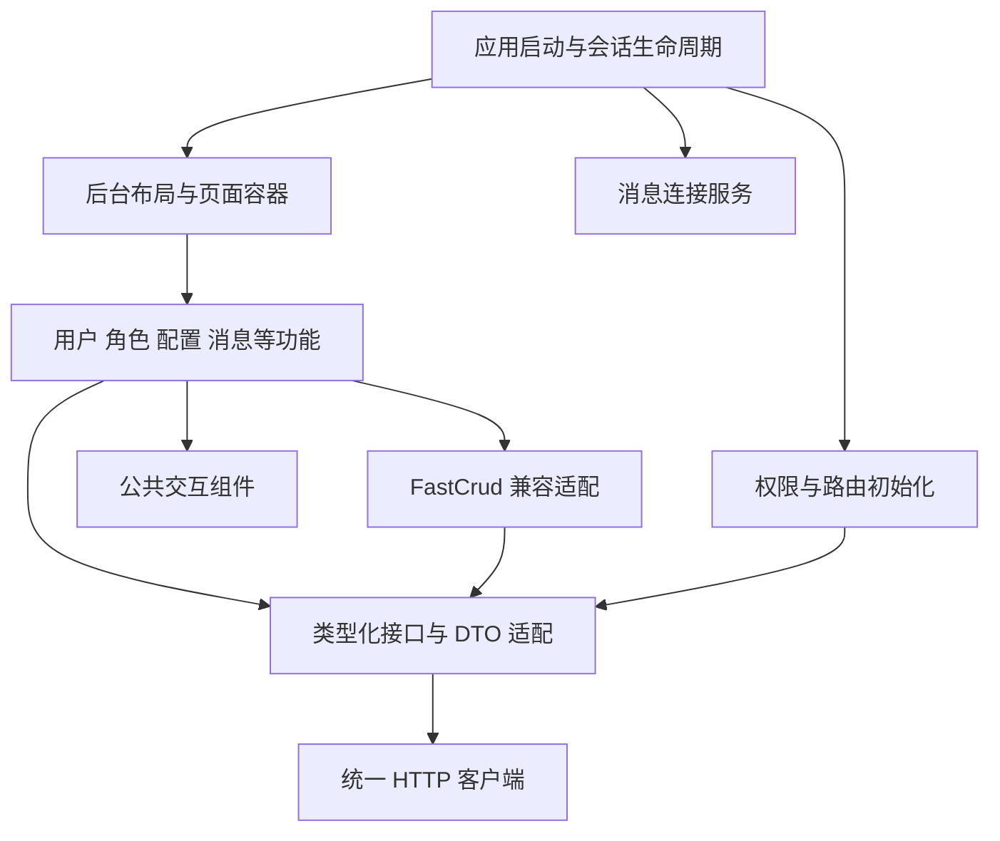

# DVAdmin 前端重构详细设计

日期：2026-10-24。状态：设计提案；本轮只编写方案，未实施以下代码改动。

## 1. 目标与范围

将清理后的 DVAdmin 改造成交互一致、权限状态可靠、适合 AI 辅助维护的管理后台。优先改善用户找页面、筛选数据、编辑记录、分配权限、理解错误和恢复操作的体验。

保留 Django API、JWT 认证约定、动态菜单、按钮权限、字段权限、部门数据范围、系统配置、字典、文件、消息、日志、个人中心，以及通用 Celery、审批插件。设计工单、商品提报、作品集与测试请假业务不再进入范围。

本轮不包含 React 重写、SSR、微前端、完整移动端重做、数据库结构重整、审批引擎改写、全新 BI 指标接口。前端发现现有接口无法满足的需求先记录，不把前端展示改造扩展成后端业务重构。

### 完成后应当看到的变化

1. 页面有清楚的标题、说明、主要操作和状态，不依赖多层卡片堆叠表达层次。
2. 用户列表能记住非敏感筛选、分页和部门；编辑成功后仍在原上下文中。
3. 授权界面清楚说明哪些变更已经生效、哪些尚待保存，失败后不显示成功状态。
4. 登录初始化、权限获取、失效处理、消息连接具有明确生命周期，避免页面自行拼接流程。
5. 真实数据缺失时显示空态或不可用状态；首页不再以写死的统计值代表真实业务。
6. 新组件有明确类型和示例；AI 的修改能通过构建、类型检查和关键交互测试验证。

## 2. 当前基线与证据

本轮重新统计：`views` 下 135 个 Vue 文件（包含子组件），27 个 `crud.tsx`。前次清理已验证本机数据库保留 27 个系统/插件菜单；本轮不把菜单数量当作页面数或功能覆盖率。

| 现状 | 源码位置 | 对方案的影响 |
| --- | --- | --- |
| 四套布局动态切换，1000px 下有单独移动逻辑 | `web/src/layout/index.vue`、`layout/main/` | 首先升级 defaults 布局，共享 token；另外三套保留兼容，不同时重做四套交互 |
| 路由转换分散在 backEnd、frontendMenu、utils/menu | `web/src/router/backEnd.ts`、`stores/frontendMenu.ts`、`utils/menu.ts` | 先确认实际调用链与外链分支，再统一成一个转换入口 |
| 两份 Store 使用相同 `BtnPermission` ID | `stores/btnPermission.ts`、`plugin/permission/store.permission.ts` | 统一定义和导入，不能将重复定义简单认定为两个独立实例 |
| 权限获取函数内部启动 Promise，却没有等待请求完成；指令仅 mounted 删除 DOM | 上述 Store、`directive/authDirective.ts` | 需要初始化屏障及响应式权限，避免加载竞态和更新后不可恢复 |
| 字段权限处理覆盖 addForm/editForm 配置，部分页面没有调用此适配器 | `utils/columnPermission.ts`、`views/system/user/` | 明确页面能力矩阵，合并配置时保留校验/联动；不得假设所有页已具备字段权限 |
| 两个 Axios 入口成功码、默认超时、失败处理不同 | `utils/request.ts`、`utils/service.ts` | 以实际调用方为依据设计兼容入口，禁止直接全局替换返回结构 |
| service 实例超时 20 秒，包装函数默认覆盖为 5 秒 | `utils/service.ts` | 盘点最终生效配置，下载/上传/普通读取分别定义策略 |
| 生产环境 beforeEach 等待版本文件请求，发现版本变化直接刷新 | `router/index.ts`、`utils/upgrade.ts` | 版本检查脱离路由关键路径，存在未保存内容时延后更新 |
| 主题版本变化执行 Local.clear；token 实际在 localStorage | `App.vue`、`utils/storage.ts` | 主题迁移可能影响登录；采用按键迁移，保持现有认证契约 |
| WebSocket 重连调用 init(null)，close 缺少空值与定时器完整清理 | `utils/websocket.ts` | 重连回调丢失与资源清理列为验证项，统一连接所有权 |
| 部分 mitt 注册与 off 使用不同匿名函数 | `App.vue`、`layout/routerView/parent.vue` | 改成同一处理器引用，验证热切换与反复挂载不增加监听 |
| 全局 reset 强制移除 outline，抽屉有写死白底与视口高度 | `theme/app.scss`、`role/components/RoleDrawer.vue` | 恢复键盘焦点，使用容器布局和语义色，避免暗色/窄屏失效 |
| 配置页 940 行、个人中心 907 行、首页 804 行 | 对应 `views/system/*/index.vue` | 按职责拆分，优先模块边界，不设机械行数 KPI |
| main 全量安装 Element Plus、VXE 和多个图标资源 | `main.ts`、`settings.ts` | 用生产测量验证按需加载收益，不能仅凭包名判定首屏瓶颈 |
| ESLint 9 配合旧 eslintrc/旧 parser；无 typecheck 和单测脚本 | `package.json`、`.eslintrc.js` | 首先验证工具链可运行，迁移 flat config 与 parser 兼容版本 |
| Tailwind content 只覆盖 vue/js | `tailwind.config.js` | 新增 ts/tsx 样式类可能遗漏，实施时修复扫描范围并限制动态拼接 |
| E2E 固定 8080/8000，当前本机为 8200/9000 | `playwright.config.ts`、`tests/i18n/fixtures/auth.ts` | 用环境参数贯通前后端地址，不能直接沿用测试脚本 |
| 认证 fixture 在导航前操作 localStorage；fixture 类型没有声明 page | 同上 | 首先验证 origin 与类型，改为目标 origin 的 storageState/addInitScript |
| CI 默认在 web 目录，却在启动后端步骤 cd backend；没有测试库初始化步骤 | `.github/workflows/playwright-i18n.yml` | 重建测试启动流程；显式安装 pnpm、Python 和系统依赖并生成隔离数据 |

以上是代码事实与风险推断。除已有清理验证外，本轮未运行全站浏览器测试，不将风险描述为已复现故障；性能和 UI 问题需在阶段 P0 测量。

## 3. 技术决策

### ADR-01：保留 Vue 3 + Element Plus，分层渐进改造

Vue Router、Pinia、FastCrud 继续使用。Vben 作为信息架构、主题与公共布局的参考，不在首批直接搬入其 monorepo 或权限模型。Vben 支持 Element Plus 并不意味着 dvadmin 的菜单、字段权限和插件能自动兼容。

React 迁移会同时重做现有 Vue 插件、CRUD、指令与布局，不适合当前“保留系统能力、改善体验”的目标。shadcn-vue 的开放组件源码有利于定制，但新增第二套弹层、表单和样式体系需额外验证。

**决策门槛：** P2 试点若无法通过现有组件实现所需交互，再为独立页面建立 shadcn-vue 原型，验证主题、Tailwind、Portal、z-index、焦点、暗色模式与维护成本。评估单独排期，不默认混装两套基础组件。

### ADR-02：以 CSS 语义 token 建立设计系统

新建轻量 `shared/ui`，只封装页面结构、操作反馈、表单容器和空态。表格、树、日期、选择器继续直接使用 Element Plus；不再包装一套只改名字的 Button/Input，也不创建通用页面 DSL。

保留 Tailwind 3 和现有 Sass；新模块采用 token + scoped 样式，少量工具类辅助。Tailwind、Vite、TypeScript 等大版本升级单独验证，不与页面迁移打包一次完成。

### ADR-03：FastCrud 承担标准 CRUD，自定义组件承担复杂交互

普通列表保留 FastCrud 请求、分页、表单机制。用户管理用组合式布局承载部门树与 CRUD；角色授权、系统配置、审批设计器使用显式组件，不为统一形式强塞进 CRUD schema。

只扩展分页转换、字段权限、筛选恢复等已有共性；出现至少两个真实调用点后再提取公共抽象。

### ADR-04：先统一请求契约，再决定 Vue Query

第一批保持 Axios；为普通列表和 FastCrud 保留兼容适配层。Vue Query 仅作为后续跨页面共享读取的候选，不接管同一 FastCrud 列表，也不为每页增加第二套缓存。

若引入：明确 staleTime、焦点重新拉取、retry、权限缓存失效和账号切换清理。编辑草稿不能被后台刷新覆盖；授权写入不自动重试、不采用乐观成功。不能直接沿用库的默认缓存行为。

### ADR-05：单应用、分批发布、保持既有地址

保留 hash 路由及数据库存储的 component 标识。需要搬动页面时保留旧入口 re-export 或建立显式组件映射。先不引入微前端，不批量改菜单数据库路径。

## 4. 目标结构与依赖方向



建议新增目录，按迁移逐步建立：

```text
src/
  app/                    # bootstrap、session、router、preferences、realtime
  shared/
    api/                  # client、envelope、pagination、error
    ui/                   # PageContainer、PageHeader、AsyncState、FormDrawer
    composables/          # useListQueryState、useUnsavedChanges 等
    styles/               # tokens、Element Plus 映射、focus 样式
  features/
    users/                # api、types、components、composables、tests
    roles/                # permission editor、scoped draft、API types
  integrations/
    fast-crud/            # 分页/权限适配，复用已存在 settings 注册
  views/                  # 保留现有菜单组件入口，逐页引用 features
  layout/                 # 默认布局渐进替换，保留其他布局
  stores/                 # 旧导出兼容，逐步归并职责
```

页面可依赖 shared、feature API 和适配层；shared 不依赖具体页面；接口层不导入 UI 弹窗；公共组件不直接读取用户页 Store。旧入口兼容不复制业务逻辑。插件继续放在原目录，优先通过布局、主题和请求边界接入。

## 5. 信息架构与视觉交互

### 5.1 导航和页面布局

菜单仍由后端权限结果生成。展示上分为工作台、系统管理、通用配置、日志、任务、审批，按用户实际可访问项呈现，不修改数据库菜单 ID 和授权关系。

默认布局建议：侧栏 224px/折叠 64px，顶栏 56px，标签栏约 36px，内容边距桌面 20px、窄屏 12px。它们是原型起点，不是性能或无障碍标准。四种布局共享 token；首批只升级 defaults，其他布局做兼容冒烟。

1280px 及以上展开侧栏；768–1279px 优先收起导航和树面板；更小视口导航改抽屉，表格在自身区域横滚。页面整体不产生无意义横向滚动，审批设计器内部画布可滚动。表单支持 200% 缩放与主要键盘操作。

每页结构：标题/说明 → 主要操作 → 筛选 → 结果摘要 → 内容 → 分页。错误或加载反馈放在受影响区域；不让全屏 loading 遮住已可使用的区域。默认页仅一个主操作，批量操作在选择记录后出现。

### 5.2 设计 token 与反馈

| 领域 | 规则 |
| --- | --- |
| 颜色 | 定义 surface、canvas、text、muted、border、primary、success、warning、danger；映射现有 `--el-*` 和 `--next-*` |
| 间距 | 4/8/12/16/20/24/32；页面和表单按同一尺度使用 |
| 字体 | 常规 14px、说明 12–13px、页面标题 20px；数字和正文区分但不全面加粗 |
| 密度 | 默认和紧凑两档，映射现有组件 size；保留旧 large 配置兼容，不新增更多偏好 |
| 表单 | 标签、必填、帮助、错误位置统一；提交失败跳到首个错误并保留输入 |
| 状态 | initial/loading/success/empty/error 分开；空数据、无搜索结果、无权限不得共用“暂无数据” |
| 键盘 | 恢复 focus-visible；抽屉/对话框限定焦点、关闭后回到触发按钮；Esc 尊重未保存状态 |
| 动效 | 120–180ms 的轻量过渡；尊重 prefers-reduced-motion；不在每次表格更新时播放入场动画 |

不以模糊背景、强渐变或大量卡片作为现代化目标。图标先统一新增代码的来源，旧 iconfont 由映射保留，后续按使用量淘汰。

### 5.3 页面级交互

**工作台：** 展示当前身份、可用快捷入口、最近访问和真实通知。待办仅在已有接口和权限支持时展示；取不到指标就不渲染统计卡。图表延迟加载，不作为进入后台的前置依赖。

**用户管理：** 左侧部门树可折叠与搜索，选中状态明确；右侧默认查询全部可授权数据，点击部门重新从第 1 页查询。搜索、清空、分页不重复触发同一请求；仅最新请求能更新结果。新建/编辑使用统一抽屉，支持错误定位、按钮 loading、重复提交抑制。删除、密码重置采用明确对象名称的确认，错误后保留上下文。

筛选状态分层：可分享且非敏感的 page/pageSize/sort/deptId 可进 URL；姓名、电话、邮箱搜索留在按账号隔离的 session 内；密码、token 和敏感表单不进查询参数或持久缓存。返回列表优先恢复已有状态，权限变更后校正已失效部门及页码。

**角色授权：** 明确菜单权限、操作权限、数据范围、字段权限四层。数据范围值保持 0=本人、1=本部门及下级、2=本部门、3=全部、4=自定义部门。保留已有后端授权约束，不自行推导父子菜单或字段联动规则。

首版忠实展示现有保存边界：菜单勾选即时生效，显示行内保存/失败并在失败时恢复服务端值；按钮批量操作仅在已有接口支持范围内提交；字段以当前菜单为单位显式保存，并显示未保存标记。切换菜单/角色/关闭时处理未保存字段。保存中的旧角色/菜单请求不能写回新上下文。

**不提供伪原子的“保存全部”。** 现有菜单、按钮、字段是不同请求，逐个请求并不构成事务。如后续需要统一提交，必须新增可校验、可事务化的后端聚合接口，并另行估算。首版不承诺权限变更实时推送其他登录会话；重新登录/权限重新获取后的表现及后端拒绝行为必须正确。

**配置、字典、文件与消息：** 配置页按分区展示，复杂 JSON 编辑器仅进入相应分区时加载；文件选择保留进度、取消/失败状态，异步导入导出跳转下载中心；消息点击只标记对应记录已读，不把全部记录设为已读。

**日志与插件：** 日志保留筛选和详情返回位置；Celery 的运行状态以服务端为准；审批设计器保留自身布局与滚动容器。通用审批页面、H5 构建和已停用业务模型的历史快照均列入兼容回归。

## 6. 会话、路由与权限生命周期

启动过程：读取当前会话 → 获取用户 → 等待必要权限与菜单 → 校验/转换路由 → 注册路由 → 渲染目标页面 → 后台加载可选字典、配置和消息连接。菜单、权限加载失败必须提供重试或退出入口，不能按空权限完成初始化。

- 使用共享 bootstrap Promise，刷新和并发导航复用同一次初始化；在 finally 中结束进度状态。
- 路由组件解析改为归一化后的精确映射，兼容目录、外链、iframe 和 node_modules 插件入口；缺失组件降级为明确错误页并记录组件键。
- 路由名称、标签键、KeepAlive 缓存键分别定义；同一路由不同参数是否共享实例由页面策略决定。登出和账号切换注销动态路由、清空权限和该账号缓存。
- 权限 Store 只保留一个定义；旧模块 re-export 同一实例，使用 loading/ready/error 状态。页面未准备好时不展示敏感动作。
- 新页面使用响应式 `can/canAny/canAll` 或权限组件；旧指令渐进兼容更新，不依赖一次性删除 DOM。
- 字段策略区分 query/create/update；禁止用户通过列设置重新开启不可查询字段。适配器保留原有 form validators 和组件配置。
- 权限缓存按账号与权限获取结果隔离；不能信任上个账号的持久化 Store。前端隐藏仅负责交互，后端接口/字段/数据范围校验是最终边界。
- 初次改密、SSO 参数清理、锁屏、无权限、404、深链刷新分别回归；保留 JWT header 与现有 token 存储契约，存储策略变更另作认证设计。

## 7. 请求、状态和消息连接

### 7.1 API 契约

为 DVAdmin 标准响应定义 `ApiEnvelope<T>`（code/msg/data）和独立分页扩展（page/limit/total）；成功码按已确认接口使用 2000。特殊第三方响应、Blob、上传和外部请求明确分流，不套用同一成功码判断。列表 `{page, limit, ordering}` 转换与 FastCrud `{records,currentPage,pageSize,total}` 转换集中维护。

兼容 `utils/service.ts` 和 `utils/request.ts` 现有导出，逐调用方迁移；旧入口调用统一 client，必要时通过 adapter 保持原返回契约。迁移前列出所有导入点并给出删除条件。

请求层产出结构化错误：network/timeout/cancelled/auth/forbidden/validation/business/server。页面决定字段错误和局部重试，统一协调器决定会话失效；同一错误只通知一次。取消请求不弹失败提示。401 并发时只触发一次会话清理和跳转，403 保留当前上下文。

GET 搜索使用 AbortController 或请求序号，晚返回数据不能覆盖新条件；POST/PUT/DELETE 不自动重试。普通读取、上传、下载分别使用显式 timeout。后端没有幂等键时，禁止将写入请求“失败重试”当作安全恢复，先允许用户核对服务端结果。

### 7.2 状态归属

| 状态 | 所有者 | 清理/更新规则 |
| --- | --- | --- |
| 当前用户、路由、权限 | app session + Pinia | 账号切换、登出清理；重新初始化后替换 |
| 主题、密度 | preferences | schemaVersion 按键迁移；保留认证和其他来源数据 |
| 当前列表结果 | FastCrud/页面 | 搜索、分页更新；不再复制进全局 Store |
| 表单与授权草稿 | 当前抽屉/编辑会话 | 提交成功更新基线，关闭确认后销毁 |
| 列设置与非敏感筛选 | 账号+页面版本命名空间 | 与权限求交集；旧版本迁移/失效 |
| 字典与部门共享读取 | 明确的共享读取层 | 按账号及刷新策略管理；不跨账号复用权限相关数据 |
| 未读数量和连接状态 | realtime + message store | 重连后重新拉取权威数量，事件仅作刷新提示 |

### 7.3 实时连接与版本更新

WebSocket 由 app session 唯一持有，登录后连接、登出时关闭。消息 handler 跨重连保留；重连使用有上限的指数退避，主动断开不重连；释放心跳、超时、网络监听及旧实例。异步回调需校验会话代次，防止旧账号消息进入新会话。所有消息先解析/校验，渲染富文本须按既定可信来源和净化策略处理。

版本文件低频后台检查（初始建议 5 分钟、可配置）；网络失败不阻断导航。发现新版本显示更新提示；未保存表单存在时延后刷新。部署保留前一版带 hash 资源，避免旧标签切换时 chunk 404。

## 8. 工程与性能

### 工具链

P0 固定 pnpm 版本和支持的 Node LTS，确保 lockfile 冻结安装可复现。验证 ESLint 9 flat config 与 parser/plugin 的兼容，补充计划中的 `lint`、`typecheck`、`test:unit`、`test:e2e`；这些脚本目前不存在，不能在实施前视为已可运行。

采用适配当前 TS/Vue 的 vue-tsc；如需升级 TS，先建立基线并限定兼容改动。旧代码问题列入有负责人和到期条件的基线，新模块不得新增未检查的 any。依赖大版本迁移独立提交验证，避免 UI 回归与工具链回归混淆。

### 性能目标与测量方法

本轮读取现有 `dist/assets` 最大 JS 文件约 2.59MB、2.09MB、1.04MB（原始文件字节量级），只是上一轮产物快照，不代表首屏下载量。首次实施应在生产 preview、固定数据集和设备上建立请求瀑布与 chunk 依赖基线。

| 指标 | 暂定验收目标 | 方法 |
| --- | --- | --- |
| 导航与输入反馈 | 本地 UI 反馈 p95 ≤100ms，不含 API 等待 | 固定 Chrome 环境、重复操作至少 30 次 |
| 搜索正确性 | 连续输入/切换部门，只显示最新查询结果 | 注入乱序响应和慢网测试 |
| 重复提交 | 一次点击只发一个写请求，提交中不可重复 | 浏览器请求计数 |
| 初始脚本 | defaults+home 冷启动 gzip JS 较 P0 基线减少至少 20% | 相同构建与场景，排除按需访问插件 |
| 主要功能可用时间 | p75 不比基线恶化超过 10%，记录目标设备与网络 | 冷/暖启动各至少 20 次；样本为本地评估，非线上 SLO |
| 资源释放 | 页面/抽屉反复进出 20 次，监听与连接不持续增长 | Vue/浏览器诊断与请求观测 |

以上为待基线校准的目标，不是已经达到的结果。优化顺序：启动依赖 → 重型编辑器/图表按需加载 → 组件与图标安装范围 → 列表渲染 → 缓存。虚拟表格仅在真实数据下证实必要时使用；先采用服务端分页和筛选。

## 9. 测试与验收矩阵

### 测试环境

E2E 使用独立数据库和专用账号，禁止默认对当前工作数据库写入测试数据。统一 WEB_BASE_URL/API_BASE_URL；在对应 origin 写入会话状态，再导航。密码来自测试环境，失败报告不输出 token。CI 显式指定 backend 工作目录、初始化库与角色、建立有效就绪探测，不以登录 GET 必须返回 200 为前提。

单元测试覆盖真实逻辑：响应归一化、权限组合、精确路由映射、偏好迁移、请求乱序和会话重连。组件测试覆盖焦点恢复、未保存提示、权限异步更新、不同保存区域反馈。E2E 覆盖端到端操作和失败恢复，减少固定 sleep，等待具体元素/响应；WebSocket 存在时不等待 networkidle。

| 场景 | 用户/条件 | 必须验证 |
| --- | --- | --- |
| 登录、刷新、深链 | 超管、普通角色、未登录、初次改密 | 单次初始化、返回地址、404/403、进度正确结束 |
| 账号切换/会话过期 | A 登出后 B 登录，并发 401 | 无前账号菜单、权限、筛选或消息残留；只跳转一次 |
| 用户列表 | 只读、可写、受限部门角色 | 部门/分页/排序正确；快速查询结果不串；返回恢复 |
| 用户写入 | 表单错误、慢网、断网 | 内容保留、首错定位、无重复提交、服务端结果可核对 |
| 操作权限 | 无新增/删除/导出权限 | 控件正确，直接请求仍由后端拒绝 |
| 字段权限 | query/create/update 不同 | 列设置不能恢复隐藏字段；请求/响应字段按后端契约核验 |
| 授权 | 快速换角色/菜单、保存失败 | 不串写；失败不报成功；未保存字段可放弃或继续编辑 |
| 数据范围 | 0–4 及自定义部门 | 验证后端实际返回记录集合，不只检查选择器文案 |
| 主题/布局/无障碍 | 明暗、紧凑、缩放、键盘 | 焦点可见、抽屉可关闭、保存可触达、主要操作无遮挡 |
| 插件与历史 | Celery、审批列表/设计器、H5 | 状态正确，通用插件入口可用，退役模型快照不崩溃 |
| 国际化 | 简中、繁中、英文 | 标题/表单/校验更新；缺失翻译与英文长标签回归 |
| 消息与更新 | 断线重连、多个标签、新版本 | handler 保留；不重复提示；未保存内容不被刷新清除 |

上线门槛：试点关键场景全部通过；无新增阻断错误；构建、类型与 lint 满足该批范围；同一构建产物通过验收；保留报告与回退路径。全站验收必须覆盖插件与非默认布局，不能由首页截图或生产构建替代。

## 10. 分阶段工作量与交付

| 阶段 | 交付 | 前置条件 | 工程人日 |
| --- | --- | --- | --- |
| P0 基线与工具链 | 路由/权限清单、请求契约、隔离测试数据、可运行质量检查、页面原型 | 清理后的代码基线 | 3–4 |
| P1 公共基础 | session/bootstrap、权限来源归一、请求兼容层、主题 token、默认布局 | P0 契约和测试启动通过 | 4–6 |
| P2 用户/角色试点 | 新列表/表单/分区授权、权限与失败恢复回归 | P1；以真实 API 验证保存边界 | 4–6 |
| P3 按模块推广 | 配置、字典、文件、消息、日志、首页及插件适配 | P2 验收；公共组件稳定 | 5–7 |
| P4 发布与回归 | 全站矩阵、性能对比、资源/版本更新、回退演练 | P3 功能完成 | 3–4 |

合计 19–27 工程人日，另留兼容性缓冲 3–5 人日，完整范围建议按 **22–32 工程人日** 规划。P0+P1 为 7–10 人日，用户/角色试点完成累计约 11–16 人日，均不含缓冲。估算不是 AI 实际执行时长承诺。

上一版 14–20 人日适用于公共视觉和基本交互升级；本版新增权限初始化归一、测试环境修复、资源生命周期、发布回退等完整工程要求，因此取代旧估算。若仅做基础体验版，应明确删减上述工程范围及相应验收，不能对外仍承诺完整方案。

独立候选项：Vben 底座迁移、shadcn-vue 全局采用、授权聚合事务接口、完整移动端重做；本估算不叠加这些项目，需分别原型和报价。

## 11. 迁移与回退策略

1. 开始实现前，将当前定制模块清理及其他已有修改按来源整理成可追踪基线；不擅自重置、合并或提交其他工作的改动。
2. 按基础设施、用户试点、角色试点、批次推广拆分改动。部署开关与偏好设置分开，访问权限不由本地开关决定。
3. 小范围启用新 defaults 布局和试点页，保留旧入口/布局。新旧页面不能同时注册同一路由；由构建配置或唯一映射选择实现。
4. 偏好迁移只读取旧值并写新版本键，至少一个发布窗口保留旧键。授权映射和筛选按账号隔离，不清空整个 origin 的存储。
5. 回退到上一前端制品，保持 API、菜单 component 路径及旧资源可用。回退不撤销已成功提交的用户/权限业务操作，不以恢复数据库快照替代版本回退。
6. 每批记录启用条件、变更页面、接口契约、测试证据、已知问题和回退操作；只在确认新入口覆盖后删除旧适配层。

## 12. 开始编码前的决策与下一步

本方案默认专业、简洁、偏紧凑风格，保留浅/深色；桌面优先；保留四种布局但首批只重构 defaults。无需为这些可逆选择再次阻塞工作，原型评审时可调整。

下一批先完成 P0：隔离测试环境与质量门禁、绘制默认布局/用户列表/授权抽屉原型、核实 API 契约和角色矩阵、记录生产预览性能。得到可运行基线与原型后进入 P1；本轮不提前修改业务实现。

任务拆分和完成条件见 [实施任务清单](frontend-refactor-backlog.md)。

## 13. 官方参考

以下是能力和默认行为的参考，技术路线与工作量为本项目判断，不是来源提供的结论：

- [Vben 组件库适配](https://doc.vben.pro/guide/in-depth/ui-framework.html)：支持多种业务组件库；迁移仍需项目适配。
- [shadcn-vue Vite 安装](https://www.shadcn-vue.com/docs/installation/vite)：评估现有 Vite/Tailwind 配置与组件接入边界。
- [Vue 性能指南](https://vuejs.org/guide/best-practices/performance.html)：先分析依赖和实际开销，再采用拆分与列表优化。
- [TanStack Vue Query 默认行为](https://tanstack.com/query/latest/docs/framework/vue/guides/important-defaults)：使用前明确缓存、重取与重试策略。
